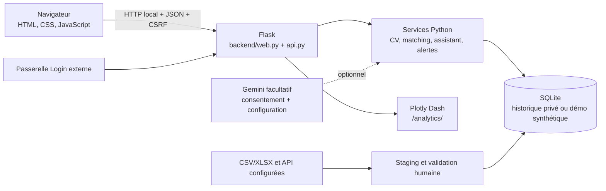

# Architecture technique

## Vue d'ensemble

Les pages sont des fichiers HTML dans `dashboard/`. `backend/web.py` construit l'application Flask, applique la session et le contrôle CSRF, puis enregistre les routes d'API. `backend/api.py` lit les données via les services et `backend/db.py`. Le dashboard Dash est monté sur le serveur Flask avec le préfixe `/analytics/`.

## Profils

### Local privé

`LANCER_SOUTENANCE_LOCALE.bat` choisit `database/stages_marrakech.db`, désactive le mode démo et lance la vérification locale. La connexion historique est une session applicative à mot de passe unique gérée par `backend/security.py`. Cette session protège l'accès local, mais ne partitionne pas CV et candidatures par compte utilisateur.

### Démo publique

`scripts/serve_public_demo.py` et `render.yaml` sélectionnent la base `database/stages_marrakech_public_demo.db`. `backend/web.py` exige l'attestation de mode démo et contrôle le marqueur `synthetic_public_demo`. Le mode public limite les écritures et désactive les services externes.

### Passerelle d'authentification

`auth_gateway/` est une couche séparée qui relaie les requêtes au backend. Son profil `demo` sert la base synthétique; son profil `private` exige un administrateur nommé et désactive l'inscription. Ce relais ne crée pas de cloisonnement par utilisateur dans le cœur Flask. L'inscription publique et le stockage de CV/candidatures personnels partagés ne conviennent donc pas à une mise en production multiutilisateur.

## Dépendances et déploiement

- Python 3.12, Flask, Werkzeug, SQLite, Pandas, Dash/Plotly, ReportLab, openpyxl, requests et cryptography sont déclarés dans `requirements.txt`.
- `backend/wsgi.py` expose `app` à Gunicorn. `render.yaml` configure une démonstration sur Render et sélectionne le jeu public synthétique.
- Les variables d'environnement du profil privé et les secrets de `.env` sont locaux. Ils ne doivent pas rejoindre l'archive publique.
- L'hébergement public n'a pas été exécuté ni testé. La configuration Render avec disque éphémère ne constitue pas une preuve de stockage persistant pour les comptes.

## Sécurité observée

Le backend utilise un cookie de session HttpOnly/SameSite, un contrôle d'origine, un jeton CSRF et une clé locale pour chiffrer le CV enregistré. Les routes mutantes contrôlent la session. La passerelle garde le cookie interne côté serveur. Ces contrôles ne remplacent ni une séparation des données par utilisateur, ni un audit de sécurité, ni une configuration HTTPS correctement hébergée.
